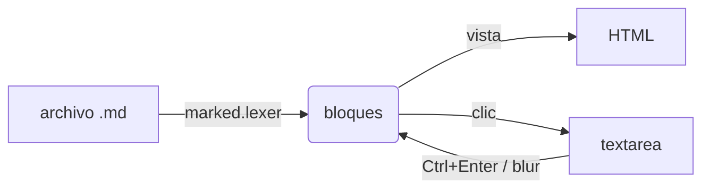
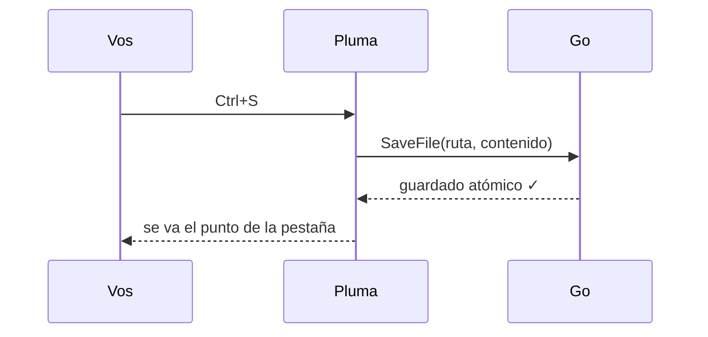
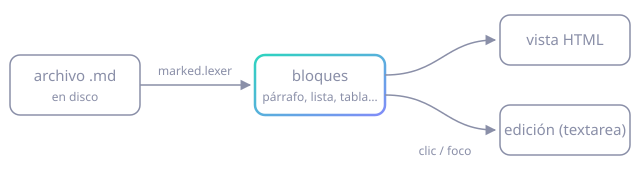

# Bienvenido a Pluma

Pluma es un editor de Markdown **liviano** donde el documento *es* la vista previa: no hay pantalla dividida. Este archivo muestra todo lo que soporta. Editalo sin miedo: cada vez que lo abrís desde **Ayuda → Documento de ejemplo** vuelve a su versión original.

## Cómo se edita

- **Clic** en cualquier bloque (párrafo, título, lista, tabla…) para editarlo. Arriba aparece un panel chico con el formato.
- Hay dos modos, a elección (en el panel o en **Ver**): **Markdown** muestra el texto crudo; **Visual** edita el bloque tal como se ve, con el cursor donde hiciste clic.
- En modo visual, un bloque que abrís y no cambiás se guarda exactamente como estaba. El código, las tablas, el HTML y los diagramas se editan siempre como Markdown.
- <kbd>Ctrl</kbd> + <kbd>B</kbd> / <kbd>I</kbd> / <kbd>K</kbd> mientras editás: negrita, cursiva y link.
- <kbd>Esc</kbd> descarta los cambios; <kbd>Ctrl</kbd> + <kbd>Enter</kbd> o hacer clic afuera los confirma.
- Una línea en blanco dentro de un bloque lo divide en dos; si lo dejás vacío, se borra.
- Clic en el espacio libre al final del documento para agregar un bloque nuevo.
- Arrastrá uno o varios `.md` a la ventana para abrirlos en pestañas.

### Atajos

| Acción | Atajo |
| :-- | :-- |
| Abrir (uno o varios) | <kbd>Ctrl</kbd> + <kbd>O</kbd> |
| Guardar / Guardar como | <kbd>Ctrl</kbd> + <kbd>S</kbd> / <kbd>Ctrl</kbd> + <kbd>Shift</kbd> + <kbd>S</kbd> |
| Nueva pestaña / Cerrar | <kbd>Ctrl</kbd> + <kbd>T</kbd> / <kbd>Ctrl</kbd> + <kbd>W</kbd> |
| Cambiar de pestaña | <kbd>Ctrl</kbd> + <kbd>Tab</kbd> |
| Barra lateral (sin editar un bloque) | <kbd>Ctrl</kbd> + <kbd>B</kbd> |
| Negrita / cursiva / link (editando) | <kbd>Ctrl</kbd> + <kbd>B</kbd> / <kbd>I</kbd> / <kbd>K</kbd> |
| Escalar la fuente | <kbd>Ctrl</kbd> + <kbd>+</kbd> / <kbd>−</kbd> / <kbd>0</kbd>, o <kbd>Ctrl</kbd> + rueda |
| Abrir un link | <kbd>Ctrl</kbd> + clic |

## Texto

Párrafo con **negrita**, *cursiva*, ***ambas***, ~~tachado~~, `código en línea`, <mark>resaltado</mark>, H<sub>2</sub>O y E = mc<sup>2</sup>.
Un salto de línea simple se une al texto anterior;
para cortar la línea, terminala con dos espacios o usá `<br>`.<br>Así.

Links: [Wails](https://wails.io), [marked](https://marked.js.org) y autolinks como https://svelte.dev. Abrilos con <kbd>Ctrl</kbd> + clic.

Emojis y Unicode: ✒️ 🪶 · ñ á ü ç · → ≠ ∞ ✓

> **Citas.** Pueden tener *formato* y anidarse:
>
> > Lo que bien se concibe, bien se expresa. — Boileau

## Listas

- Elementos con viñeta
  - anidados
    - en varios niveles
- Otro elemento

1. Numeradas
2. Con orden
   1. y sub-numeración
   2. en varios niveles

- [x] Listas de tareas
- [x] Con casillas marcadas
- [ ] Y pendientes: hacé clic en la casilla para marcarla

## Código

Los bloques de código pueden tener líneas en blanco sin partirse en dos:

```go
// saludo arma un saludo personalizado.
func saludo(nombre string) string {
	msg := "Hola, " + nombre

	return msg + "!"
}
```

```json
{ "nombre": "Pluma", "version": "0.1.0", "liviano": true }
```

    Bloque indentado con cuatro espacios.

## Diagramas (Mermaid)

Un bloque de código con lenguaje `mermaid` se dibuja como diagrama. Hacé clic en él para editar su fuente.





## Imágenes

Las rutas relativas se resuelven desde la carpeta del archivo. También funcionan rutas absolutas, `file://`, URLs `https://` y `data:`.



Con HTML se puede controlar el tamaño y la alineación:

<p align="center">
  
  
  
</p>

## HTML y CSS

Se puede mezclar HTML, como este desplegable:

<details>
  <summary>Clic para desplegar</summary>
  <p>Contenido oculto. Para editar el bloque, hacé clic en cualquier parte que no sea el resumen.</p>
</details>

<p style="color: #2dd4bf; font-weight: 600; letter-spacing: .02em">Texto con estilos en línea (atributo style).</p>

El bloque de abajo es invisible: define estilos con una etiqueta `<style>`. Hacé clic en el espacio vacío para verlo. Esos estilos se aplican a toda la ventana, así que conviene usar nombres de clase propios.

<style>
  .pluma-cards { display: flex; gap: 12px; flex-wrap: wrap; margin: .5em 0; }
  .pluma-card { flex: 1 1 150px; padding: 14px 16px; border-radius: 12px; color: #fff;
    background: linear-gradient(135deg, #2dd4bf, #818cf8); box-shadow: 0 6px 20px rgba(91, 108, 240, .25); }
  .pluma-card b { display: block; font-size: 1.15em; margin-bottom: 2px; }
</style>

<div class="pluma-cards">
  <div class="pluma-card"><b>Liviano</b>Go + WebView2, sin Electron.</div>
  <div class="pluma-card"><b>Seguro</b>El HTML pasa por DOMPurify.</div>
  <div class="pluma-card"><b>Directo</b>El documento es la vista.</div>
</div>

Por seguridad, los scripts se eliminan: un `<script>` o un `onerror=` dentro del Markdown no se ejecutan nunca.

---

## Títulos

La línea de arriba es `---`. Los títulos de `#` a `######` arman el índice de la barra lateral (<kbd>Ctrl</kbd> + <kbd>B</kbd>):

#### Título de nivel 4

##### Título de nivel 5

###### Título de nivel 6

Listo. Ahora probá abrir tus propios archivos con <kbd>Ctrl</kbd> + <kbd>O</kbd> o arrastrándolos a la ventana. ✒️
